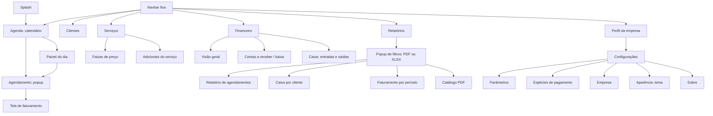
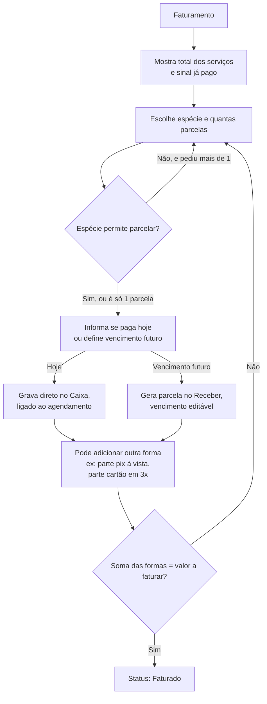
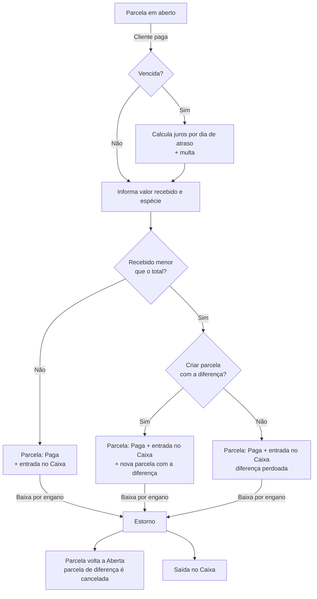
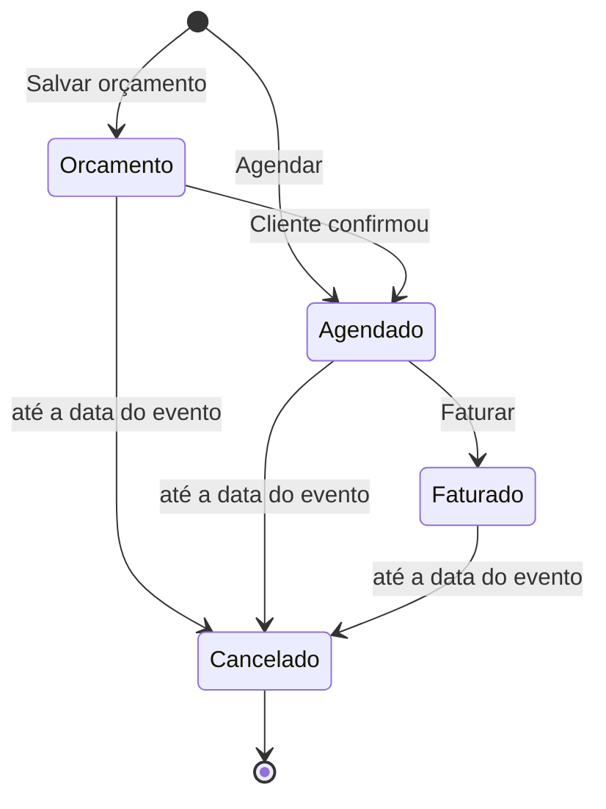

# Fluxo do Sistema – Fest Agenda

> **Modelo fechado pelo grupo em 27/09/2026.** Acompanha o `modelagem-banco.md`.
> **Atualizado em 28/09/2026:** stack fechada (.NET 10, WPF, Entity Framework Core, Firebird 5, QuestPDF), requisitos numerados (RN, RF, RNF), configurações de negócio, juros/multa, baixa parcial e regras de cancelamento.
> **Atualizado em 29/09/2026 (revisão do protótipo, aprovada pelo grupo):** novo menu (navbar fixa), splash, painel do dia, adicionais e catálogo dentro de Serviços, Financeiro com três abas, Configurações com dados da empresa e tema claro/escuro, título e horário de início/fim do evento, cliente com CPF ou CNPJ. Visual detalhado no `design-interface.md`.
> **Atualizado em 30/09/2026:** nome **Fest Agenda**; visual clean com o azul da UnC e **tema claro padrão**; splash clara, sem crédito da UnC; catálogo **fora da tela do serviço**; **agendamento em popup**; distribuição por **instalador** em `C:\FestAgenda` com **Firebird embarcado**; logo da empresa como arquivo (`CAMINHO_LOGO_EMPRESA`).

## Stack

| Item | Decisão |
|---|---|
| Plataforma | **.NET 10** (obrigatório), aplicação desktop |
| Interface | **WPF**, temas claro (padrão) e escuro (ver `design-interface.md`) |
| Banco | **Firebird 5 Embedded** (vai junto do sistema; servidor opcional pelo `config.ini`) |
| Acesso ao banco | **Entity Framework Core** (`FirebirdSql.EntityFrameworkCore.Firebird`) |
| PDF | **QuestPDF** (conferir as condições da licença Community) |
| Versionamento | **Git** |
| Distribuição | **Instalador** (Inno Setup) em `C:\FestAgenda` (ver `stack-projeto.md`) |

- Regras parametrizáveis são validadas na aplicação; o banco garante só a integridade estrutural.
- Nomes: banco em MAIÚSCULO_COM_UNDERSCORE por extenso; C# em PascalCase (classes e propriedades) e camelCase (variáveis). O EF faz o mapeamento (ver `modelagem-banco.md`).

## Mapa das telas

Uma **navbar fixa à esquerda**, igual em todas as telas; só o conteúdo à direita muda. No rodapé da navbar ficam a logo e o nome da empresa, que levam às Configurações.



## 0. Splash (abertura)

1. Imagem estática aparece na hora, antes do sistema carregar (mesmo visual da janela).
2. Janela de splash com a **logo da UnC** e o nome **Fest Agenda**, barra de progresso e o passo atual:
   - lê o `config.ini`;
   - conecta no Firebird (embarcado ou servidor, conforme o `config.ini`);
   - carrega a CONFIGURACAO (tema, dados da empresa).
3. Abre a Agenda, já no tema escolhido.

- Versão pequena no canto inferior direito. **Sem** o crédito "Desenvolvido por acadêmicos da UnC" (fica na aba Sobre).
- **Erro na abertura** (banco não encontrado, `config.ini` faltando ou inválido): a splash mostra a mensagem com as opções de abrir a configuração de conexão ou sair.
- A splash é sempre clara, independente do tema.

## 1. Agenda (tela principal)

- Visão do **mês**, com os agendamentos de cada dia em pequenas "pílulas" (hora e título), na cor do status:
  - **livre**;
  - **agendado / faturado**;
  - **orçamento com sinal** (bloqueia a data, se o bloqueio estiver ativo);
  - **orçamento sem sinal**, só com contorno, sem bloquear a data.
- Legenda fixa embaixo; destaque para o dia de hoje.
- Botão **"+ Novo Agendamento"** no topo.
- Visões **Mês**, **Semana** e **Dia** nos botões do topo (RF24); a visão escolhida fica lembrada enquanto o app estiver aberto. **Hoje** volta para a data atual na visão ativa.
  - **Semana:** 7 colunas (dom–sáb) com os agendamentos de cada dia em cards (hora início–fim, título, cliente), na cor do status. `‹ ›` avançam uma semana; clicar no cabeçalho de um dia abre esse dia.
  - **Dia:** lista vertical por horário, com os mesmos cards do painel do dia e o status real. `‹ ›` avançam um dia. Evento que passa da meia-noite aparece no dia em que começa (RN28).
  - Clicar no card abre o agendamento (popup).
- Clique no dia (visão Mês) → abre o **painel do dia**.

## 2. Painel do dia

- Painel que desliza da direita, por cima do calendário.
- Agendamentos e orçamentos daquele dia, por hora: horário de início e fim, título, cliente, serviço, nº de convidados e **status real** (Orçamento, Agendado ou Faturado).
- Botões: **Novo agendamento** (abre o popup já com a data do dia) e, em cada card, **Abrir**. O **Cancelar** fica dentro do agendamento, para evitar clique acidental.
- Se a configuração **"um agendamento por dia"** estiver ativa, cada serviço só pode ter um agendamento por dia (Agendado, Faturado ou Orçamento com sinal). Serviço ocupado não aparece disponível no novo agendamento. O bloqueio é **por serviço**: salão e área externa podem estar na mesma data para clientes diferentes.

## 3. Tela de agendamento

Abre como **popup modal** por cima da tela atual (fundo escurecido), a partir de "+ Novo Agendamento" (Agenda), "Novo agendamento" (painel do dia, com a data) ou ao abrir um agendamento. Fecha com Esc/Cancelar, perguntando se há alterações não salvas. Erros de preenchimento aparecem no próprio campo (borda vermelha + mensagem curta). Visual no `design-interface.md`.

```mermaid
flowchart TD
    A[Novo agendamento] --> B[Escolhe cliente<br/>busca ou + cadastro rápido]
    B --> C[Informa título do evento,<br/>hora de início e fim<br/>e nº de convidados]
    C --> D[Adiciona o serviço principal<br/>na grade de serviços]
    D --> E[Aparecem as faixas ativas<br/>do serviço em radio button]
    E --> F[Marca a faixa → valor preenchido<br/>e editável]
    F --> D2{Outro serviço?}
    D2 -- Sim --> D
    D2 -- Não --> G[Lista de adicionais vinculados<br/>ao(s) serviço(s) escolhidos:<br/>marca, informa quantidade,<br/>ajusta valor]
    G --> H[Total calculado na hora]
    H --> I{Tem sinal?}
    I -- Sim --> J[Informa valor e espécie do sinal<br/>→ grava direto no Financeiro]
    I -- Não --> K{O que fazer?}
    J --> K
    K -- Salvar orçamento --> L[Status: Orçamento<br/>com sinal bloqueia a data,<br/>sem sinal não bloqueia]
    K -- Agendar --> M[Status: Agendado]
    K -- Agendar e faturar --> N[Abre tela de faturamento]
```

**Título e horário:** título curto do evento (ex.: "Festa Infantil", "Casamento"). Se a hora de fim for menor que a de início, o evento termina no dia seguinte (ex.: 23:00 – 02:00); ele continua pertencendo ao dia em que começa.

**Serviços:** hoje, na prática, será um serviço por agendamento (o salão), mas a grade já permite mais de um (ex.: salão + área externa). Todo agendamento precisa de pelo menos um.

**Faixa:** ela escolhe a faixa que corresponde à data (dia de semana, fim de semana, feriado, promoção). O sistema não sugere nenhuma.

**Adicionais:**
- Só aparecem os adicionais **vinculados ao(s) serviço(s)** escolhidos (definidos na tela do serviço).
- Garçom e comida (por pessoa) pedem quantidade.
- Decoração é valor fixo.
- O sistema também mostra o **custo** dos adicionais, para ver o lucro do evento.
- Quando ela paga o garçom, lança uma **saída no caixa** ligada ao agendamento.

**O que acontece com o sinal:** é registrado **direto no caixa (Financeiro)**, ligado ao agendamento, na hora. Não gera parcela no Receber. Num orçamento, o sinal **garante a data** (quando o bloqueio está ativo).

**Converter orçamento em agendamento:** a disponibilidade é validada de novo, porque um orçamento sem sinal não reservou a data.

## 4. Tela de faturamento

Pode ser aberta na hora do agendamento ou depois, a partir dele.



**Como ficou na v1 (04/10/2026):** "Agendar e faturar" (novo) ou "Faturar" (agendamento já Agendado) grava o agendamento e abre o **popup de faturamento**:

1. Mostra o total, o que já foi pago (sinal) e o **valor a faturar** (total − pago).
2. Escolhe a **espécie** e **em quantas vezes** (1 a 48; espécie que não permite parcelamento fica em 1, RN15).
3. Escolhe o **vencimento**: **todo dia D do mês** (a 1ª no próximo dia D depois de hoje; dia que não existe no mês, como 31 em abril, cai no último dia) ou **a cada X dias** (hoje + X, + 2X...).
4. Opcional: **1ª parcela recebida hoje** — vence hoje, já entra paga, com entrada no caixa; as demais seguem a regra.
5. **Gerar parcelamento** mostra a grade (parcela, vencimento, valor, situação). Valores iguais; a diferença de centavos vai na última. O vencimento ainda pode ser ajustado na grade.
6. **Confirmar faturamento** grava as parcelas no Receber e muda o status para **Faturado**. Desistir mantém o agendamento como Agendado.

Se o sinal já cobre o total, o popup só confirma o faturamento, sem parcelas. Uma forma de pagamento por faturamento (combinar várias formas, como no fluxo acima, fica para depois).

**Desconto:** digitado manualmente, só até o faturamento.

**Depois de faturado, nada muda.** Itens, valores, desconto e formas de pagamento ficam travados. A única ação possível é cancelar.

## 5. Financeiro

Três abas:

| Aba | O que tem |
|---|---|
| **Visão geral** | Filtro de período (**Hoje**, **Esta semana** — domingo a sábado, como no calendário —, Este mês, Mês passado, Últimos 3 meses, Este ano). Os cards (faturado, recebido, em aberto = parcelas que vencem no período), o gráfico (por dia até um mês, por mês acima disso) e os últimos lançamentos respeitam o período. Parcelas vencidas em destaque (todas, independentemente do período) |
| **Contas a receber** | Parcelas em aberto e vencidas; baixa, baixa parcial e estorno (fluxo abaixo) |
| **Caixa** | Entradas e saídas por período; lançamentos avulsos; despesas do evento; estorno de à vista/sinal |

### Recebimento (baixa de parcelas)

Só existem parcelas no Receber quando algo ficou pendente (vencimento futuro). Pagamento feito na hora nunca passa por aqui.



**Tela de quitar a parcela (04/10/2026):** em Contas a receber, selecionar uma parcela em aberto e clicar **Dar baixa** (ou duplo clique). O popup mostra cliente, evento, parcela (n de N), espécie combinada, vencimento (com os dias de atraso) e valor da parcela; e pede a **data do recebimento** (multa e juros são recalculados por ela), a **espécie usada** (pode ser outra, RN20), **multa** e **juros** (já preenchidos, editáveis), mostra o **total devido** e pede o **valor pago** (já preenchido com o total). Pago menor que o total: **gerar nova parcela com a diferença** (vencimento escolhido, padrão +30 dias) ou **perdoar a diferença** (RN19). Ao confirmar: parcela Paga + entrada no caixa. **Estorno (18/10/2026):** em Contas a receber, parcela paga → **Estornar baixa** (RN21); no Caixa, sinal ou recebimento de parcela → **Estornar** (RN26). Ambos pedem confirmação.

**Juros e multa:**
```
juros por dia = valor da parcela × taxa mensal ÷ 30
juros         = juros por dia × dias de atraso
total         = parcela + multa + juros
```
Exemplo: parcela R$ 1.000,00, juros 2% a.m., multa 2%, 15 dias de atraso → juros R$ 10,00, multa R$ 20,00, total R$ 1.030,00. Mês comercial de 30 dias. Os valores aparecem preenchidos na tela de baixa.

**Estorno de pagamento à vista ou sinal:** como não há parcela, lança uma saída no caixa ligada ao agendamento.

## 6. Status do agendamento



**No cancelamento:**
- Só pode ser feito **no dia do evento ou antes**. Depois da data do evento, o botão Cancelar fica indisponível.
- O motivo é **obrigatório**: sem ele, o sistema não deixa cancelar. A data do cancelamento é gravada.
- Parcelas em aberto no Receber são canceladas e **não são cobradas**, dentro ou fora do prazo de devolução.
- Se o cancelamento for feito **até X dias antes do evento** (X definido nas configurações), tudo que foi pago — **sinal e parcelas** — é devolvido, com saída no caixa ligada ao agendamento.
- Depois desse prazo, não há devolução; o que foi pago continua no caixa.

## 7. Cadastros

| Tela | O que tem |
|---|---|
| Clientes | Lista com busca (nome, telefone, CPF/CNPJ), total de eventos e último evento. Cadastro: nome, telefone, CPF ou CNPJ (opcional), e-mail (opcional), endereço opcional (logradouro, número, complemento, bairro, cidade, UF, CEP), ativo |
| Serviços | Lista só dos espaços (a partir de, nº de faixas, nº de adicionais, status). Tela do serviço: nome, descrição, ativo, grade de **faixas** (nome livre, valor, ordem por arrastar, ativo) e lista de **adicionais** (sem "Gerar catálogo" desde 30/09/2026) |
| Adicionais | Dentro da tela do serviço: **"+ Novo"** cria o adicional já ligado ao serviço; **"+ Usar existente"** liga um adicional de outro serviço. Campos: nome, descrição, valor de venda, valor de custo, cobra por quantidade, ativo. Ao editar um adicional usado em mais de um serviço, a tela avisa. Remover da lista só desvincula |
| Espécies | Dentro de Configurações: descrição, se **permite parcelamento**, ativo |

Nenhum cadastro já usado é excluído: ele é **inativado**.

## 8. Configurações

Acessadas pelo perfil da empresa no rodapé da navbar. Tudo gravado no banco (tabela CONFIGURACAO), exceto as espécies, que têm tabela própria.

| Aba | O que tem |
|---|---|
| Parâmetros | Um agendamento por dia (liga/desliga o bloqueio por serviço); juros ao mês (%); multa (%), padrão sugerido 2%; prazo de cancelamento (dias até o evento com direito a devolução) |
| Espécies de pagamento | Cadastro de espécies |
| Empresa | Nome, CNPJ, telefone, e-mail, endereço e logo (usados no rodapé da navbar e no catálogo). A logo é copiada para `Arquivos\Empresa` (máx. 512 px); o banco guarda só o caminho |
| Aparência | Tema: Claro (padrão), Escuro ou Seguir o Windows; aplicado na hora |
| Sobre | Crédito à UnC: grupo, curso, orientador e versão |

## 9. Catálogo em PDF

- Gerado com QuestPDF, puxando direto dos cadastros, então sai sempre com o preço atual.
- **Acesso (04/10/2026):** cartão **Catálogo de serviços** em Relatórios (gera o PDF sem enviar; filtro de serviço: todos ou um) e o botão da lista de Serviços. O envio ao cliente ("Enviar catálogo", seção 8 do `ajustes.md`) entrou em 18/10/2026: botão "Enviar por WhatsApp" no popup do catálogo e "Enviar catálogo pelo WhatsApp" no menu de cada cliente.
- Cabeçalho com a logo e os dados da empresa (vindos da CONFIGURACAO).
- Formato:

```
SALÃO DE FESTAS
  Seg a Qua ................ R$   800,00
  Qui e Sex ................ R$ 1.000,00
  Fim de semana/Feriado .... R$ 1.500,00

ADICIONAIS
  • Decoração simples ...... R$   400,00
  • Buffet (por pessoa) .... R$    45,00
  • Garçom (por unidade) ... R$   150,00
```

## 10. Relatórios

A tela lista os relatórios em cartões. Ao clicar em um:

1. Abre um **popup de filtros** (modal, mesmo visual do popup de agendamento), com só os filtros daquele relatório.
2. O usuário preenche e escolhe o formato: **Gerar PDF** ou **Gerar Excel (XLSX)**.
3. O arquivo vai **direto para a pasta Downloads** do usuário, como num navegador (nome automático, ex.: `Relatório de agendamentos - 04-10-2026.pdf`; se já existir, ganha " (2)"). É registrado no `RelatorioLog` (RN31) e aparece o aviso "Arquivo salvo em Downloads" com **Abrir** e **Mostrar na pasta**. O catálogo da lista de Serviços faz o mesmo.

| Relatório | Filtros | Conteúdo |
|---|---|---|
| **Agendamentos** (RF17) | Período (data do evento), cliente, status, serviço (cada um: todos ou um) | Data, horário, título, cliente, serviço, status, total, pago e saldo; totais no fim (Total e Saldo sem os cancelados) |
| **Caixa por cliente** (RF18) | Cliente (todos ou um), período | Entradas do caixa no período (sinal, à vista e baixas de parcelas) agrupadas por cliente, com total recebido e pendente (parcelas em aberto que vencem no período) |
| **Faturamento por período** (RF25) | Período | Resumo por mês (nº de agendamentos faturados, total faturado, recebido, em aberto) e o detalhe por agendamento. Considera os agendamentos **Faturados pela DATA_EVENTO** (não existe data de faturamento); cancelados ficam fora |
| **Catálogo de serviços** (RF19) | Serviço (todos ou um) | O catálogo da seção 9. Só PDF |

- Período: "de" e "até" obrigatórios; "de" não pode ser maior que "até". Padrão: o mês atual.
- Sem dados para os filtros: aviso "Nenhum registro para os filtros informados" e nenhum arquivo é gerado.
- **PDF** (QuestPDF): cabeçalho da empresa (nome, logo, contatos), filtros usados e data de geração.
- **XLSX** (ClosedXML, RNF18): uma aba por tabela, cabeçalho em negrito, primeira linha congelada, colunas ajustadas, valores como números com formato `R$ #,##0.00`, datas como data e linha de totais; aba "Informações" com empresa, filtros e data de geração.
- **RelatorioLog:** `Log\RelatorioLog.log` na pasta do sistema, uma linha por geração (sucesso ou erro), em UTF-8:

```
2026-10-04 22:30:15 | Agendamentos | PDF  | periodo=01/10/2026-31/10/2026; cliente=Todos; status=Todos; servico=Salão Principal | OK    | C:\Users\...\agendamentos.pdf
2026-10-04 22:31:02 | Faturamento  | XLSX | periodo=01/01/2026-30/09/2026 | ERRO  | arquivo em uso
```

## 11. Arquivo `config.ini`

Só a **conexão com o banco de dados**. Dados da empresa, tema e parâmetros de negócio ficam na tabela CONFIGURACAO; imagens ficam em `Arquivos\` (o banco guarda o caminho).

```ini
[Banco]
Tipo=Embarcado          ; Embarcado (padrão) | Servidor
Servidor=localhost      ; só com Tipo=Servidor
Porta=3050
Caminho=BD\basefestagenda.fdb   ; relativo à pasta do sistema ou absoluto
Usuario=SYSDBA
Senha=masterkey
```

## 12. Instalação

- Instalador `FestAgenda-Setup-x.y.z.exe`, padrão em `C:\FestAgenda` (pasta `BD\`, `Arquivos\`, `Utilitarios\`, `config.ini`). Não precisa instalar .NET nem servidor Firebird.
- **Atualizar** (instalar a versão nova por cima) troca só o programa: banco, `config.ini` e `Arquivos\` ficam como estão.
- **Desinstalar** não apaga `BD\`, `Arquivos\` nem o `config.ini`.
- `Utilitarios\`: backup, restauração, verificação do banco e isql (ver `LEIAME.txt`).

---

## Requisitos

### Regras de Negócio (RN)

**Cadastros**
- **RN01** – O CPF ou CNPJ do cliente é opcional; se informado, precisa ser válido (CPF com 11 dígitos ou CNPJ com 14) e único.
- **RN02** – Nenhum cadastro já usado em agendamento é excluído (cliente, serviço, faixa, adicional, espécie); ele é inativado.
- **RN03** – Um serviço só aparece para agendar se tiver pelo menos uma faixa de preço ativa.
- **RN04** – Adicional que cobra por quantidade tem total = quantidade × valor unitário; os demais têm quantidade 1.

**Agendamento**
- **RN05** – Todo agendamento tem pelo menos um serviço.
- **RN06** – A faixa de preço é escolhida manualmente; o valor vem da faixa e pode ser editado.
- **RN07** – Só podem ser incluídos adicionais vinculados ao(s) serviço(s) escolhido(s).
- **RN08** – Valor de venda e custo dos itens são copiados no momento do lançamento; alterar o cadastro depois não muda agendamentos existentes.
- **RN09** – Valor total = serviços + adicionais − desconto.
- **RN10** – Disponibilidade configurável, **por serviço**. Com a opção "um agendamento por dia" ativa, o serviço fica bloqueado na data por agendamentos Agendados, Faturados ou Orçamentos com sinal pago. Com a opção desligada, não há bloqueio.
- **RN11** – Orçamento sem sinal não bloqueia a data; ao convertê-lo em Agendado, a disponibilidade é validada de novo.
- **RN12** – O sinal é gravado direto no caixa, ligado ao agendamento, e não gera parcela.
- **RN32** – O cliente nunca paga mais que o total: o sinal não pode passar do valor que falta pagar (total − já pago), e o agendamento não pode ser alterado para um total menor que o já pago.
- **RN28** – Todo agendamento tem título, hora de início e hora de fim. Hora de fim menor que a de início indica que o evento termina no dia seguinte; o evento pertence sempre à data em que começa, inclusive para a disponibilidade.

**Faturamento**
- **RN13** – O desconto é manual e só pode ser informado até o faturamento.
- **RN14** – A soma das formas de pagamento deve ser igual ao valor total menos os sinais já pagos.
- **RN15** – Espécie que não permite parcelamento aceita só 1 parcela.
- **RN16** – Pagamento no dia vai para o caixa; pagamento com vencimento futuro gera parcela no contas a receber.
- **RN17** – Agendamento faturado é imutável: itens, valores, desconto e formas de pagamento não podem mais ser alterados. A única ação possível é cancelar.

**Recebimento**
- **RN18** – Parcela vencida tem multa e juros simples ao mês, ambos configuráveis. Juros por dia = parcela × taxa mensal ÷ 30; total = parcela + multa + (juros por dia × dias de atraso). Os valores aparecem preenchidos na baixa.
- **RN19** – Na baixa com valor menor que o total, o sistema pergunta se deseja gerar nova parcela com a diferença. Se sim, cria a parcela com novo vencimento; se não, a diferença é perdoada. Em ambos os casos a parcela original fica paga.
- **RN20** – A espécie usada na baixa pode ser diferente da combinada na parcela.
- **RN21** – O estorno de baixa reabre a parcela (limpa juros, multa, valor e data recebidos) e lança uma saída no caixa, na espécie da entrada; se a baixa tinha gerado parcela de diferença, ela é cancelada junto. Não é possível estornar se a parcela da diferença já foi paga (estorna-se ela primeiro) nem em agendamento cancelado.

**Cancelamento**
- **RN22** – O motivo é obrigatório, e a data do cancelamento é registrada.
- **RN23** – Parcelas em aberto são canceladas e não são cobradas, dentro ou fora do prazo de devolução.
- **RN24** – Se o cancelamento for feito até X dias antes do evento (X configurável), todos os valores pagos — sinal e parcelas — são devolvidos, com saída no caixa ligada ao agendamento. Depois do prazo, não há devolução. Desde 18/10/2026 a devolução é uma saída para cada entrada (mesma espécie e mesma origem), apontando para ela, como o estorno; assim não se confunde com despesa do evento.
- **RN25** – Nada é apagado; todo o histórico financeiro permanece.
- **RN27** – O cancelamento só pode ser feito até a data do evento, inclusive (data do cancelamento ≤ data do evento).

**Estorno**
- **RN26** – Estorno de sinal é uma saída no caixa ligada ao agendamento, apontando para a entrada estornada. Orçamento cujo sinal foi estornado deixa de bloquear a data. Não é possível estornar sinal de agendamento faturado (o sinal já abateu o faturamento; o caminho é cancelar) nem de cancelado. O pagamento à vista do faturamento é a parcela recebida no dia e se estorna como baixa (RN21). Entrada avulsa também pode ser estornada. Saída não se estorna. Cada entrada só pode ser estornada uma vez.

**Caixa**
- **RN33** – Lançamento feito à mão no caixa (RF12, RF15): data até hoje, valor maior que zero, espécie e descrição obrigatórias. Sem agendamento é avulso (entrada ou saída); com agendamento é despesa do evento, sempre saída, e não pode ser em agendamento cancelado. Despesa não conta como pagamento do cliente nem é devolvida no cancelamento.
- **RN34** – Suprimento (dinheiro colocado no caixa, ex.: troco) e sangria (dinheiro retirado, ex.: depósito no banco) só movimentam o caixa: não são receita nem despesa, não se ligam a evento e não entram no "Recebido". Não se estornam: suprimento errado se corrige com uma sangria do mesmo valor, e saída avulsa errada com uma entrada avulsa do mesmo valor.

**Relatórios**
- **RN31** – Toda geração de relatório (sucesso ou erro) é registrada no `RelatorioLog`. Falha ao gravar o log nunca impede o relatório.

**WhatsApp (18/10/2026: servidor local com Baileys; ver `CLAUDE.md` e `prompt-whatsapp-finalizacao.md`)**
- **RN29** – Limite de mensagens enviadas por dia, **configurável** em Configurações → WhatsApp (padrão 10, de 1 a 200). Decisão de 18/10/2026: o `ajustes.md` previa 10 fixo; virou o padrão. Mensagem acima do limite fica com falha, para reenviar outro dia.
- **RN30** – Falha ou ausência do WhatsApp nunca impede salvar cliente, agendamento, faturamento ou baixa. Sem conexão, a tela de envio explica o estado e oferece "Copiar texto".
- **RN35** – Só recebe mensagem o cliente que aceita (CLIENTE.ACEITA_WHATSAPP, marcado por padrão, desmarcável no cadastro; LGPD) e tem telefone válido (DDD existente; celular de 9 dígitos começa com 9). Toda mensagem é revisada e confirmada por ela antes de sair; nada é enviado sozinho. Envio em fila, um por vez, com intervalo aleatório de 6 a 15 s.

### Requisitos Funcionais (RF)

- **RF01** – Manter clientes (pessoa física ou jurídica).
- **RF02** – Manter serviços, com suas faixas de preço e os adicionais que cada um oferece.
- **RF03** – Manter adicionais (valor de venda, custo, cobrança por quantidade), a partir da tela do serviço.
- **RF04** – Manter espécies de pagamento.
- **RF05** – Exibir calendário mensal com cores por situação (livre, agendado/faturado, orçamento com sinal, orçamento sem sinal) e legenda.
- **RF06** – Listar os agendamentos e orçamentos do dia num painel sobre o calendário.
- **RF07** – Criar e editar orçamentos e agendamentos (até faturar).
- **RF08** – Registrar sinal.
- **RF09** – Converter orçamento em agendamento.
- **RF10** – Faturar agendamento com múltiplas formas de pagamento.
- **RF11** – Cancelar agendamento até a data do evento, com devolução conforme o prazo.
- **RF12** – Lançar despesas do evento (ex.: pagamento do garçom).
- **RF13** – Consultar contas a receber e dar baixa em parcelas, com juros, multa e baixa parcial.
- **RF14** – Estornar baixa de parcela e pagamento à vista/sinal.
- **RF15** – Consultar o caixa e fazer lançamentos avulsos.
- **RF16** – Mostrar o lucro do evento (receita − custos dos adicionais − despesas). Aparece no popup do agendamento faturado e no relatório de faturamento (colunas Custos e Lucro). Despesas = saídas do caixa ligadas ao evento que não são estorno nem devolução.
- **RF17** – Relatório de agendamentos por período, cliente, status e serviço, em PDF e XLSX.
- **RF18** – Relatório de caixa por cliente (por período), em PDF e XLSX.
- **RF19** – Gerar catálogo em PDF com os preços atuais (cartão em Relatórios e lista de Serviços).
- **RF20** – Tela de configurações: parâmetros (bloqueio por dia, juros, multa e prazo de cancelamento), espécies, dados da empresa, aparência e sobre.
- **RF21** – Alternar entre tema escuro, claro ou seguir o Windows, com aplicação imediata.
- **RF22** – Painel financeiro (visão geral) com totais do período, parcelas vencidas, faturamento por mês e últimos lançamentos.
- **RF23** – Tela de abertura (splash) com a marca do sistema (logo da UnC + Fest Agenda), progresso do carregamento e tratamento de erro de conexão.
- **RF24** – Calendário nas visões Mês, Semana e Dia.
- **RF25** – Relatório de faturamento por período, em PDF e XLSX.
- **RF26 a RF30** (WhatsApp, 18/10/2026) – Conectar o WhatsApp por QR code, ver o estado e desconectar, em Configurações → WhatsApp (RF26); histórico de envios com reenvio das falhas, na mesma aba (RF27); enviar catálogo ao cliente, por Relatórios → Catálogo ou pelo menu do cliente (RF28); enviar o resumo do orçamento/agendamento pelo popup do agendamento (RF29); oferecer o envio ao salvar o orçamento (RF30). Textos editáveis com variáveis ({cliente}, {data}, {valor}...). Cobrança de parcela e lembretes ficaram para depois.

### Requisitos Não Funcionais (RNF)

- **RNF01** – Aplicação desktop em .NET 10 com interface WPF.
- **RNF02** – Banco Firebird 5, acessado via Entity Framework Core.
- **RNF03** – Regras parametrizáveis validadas na aplicação; o banco garante só integridade estrutural (FKs, domínios, CHECKs fixos).
- **RNF04** – Banco autodocumentado: nomes por extenso no padrão do Firebird (MAIÚSCULO_COM_UNDERSCORE), domínios e `COMMENT ON` em todas as tabelas e campos. No C#, PascalCase para classes e propriedades.
- **RNF05** – Valores monetários em NUMERIC(18,2).
- **RNF06** – Exclusão lógica (inativação) em vez de física.
- **RNF07** – Só a conexão com o banco no `config.ini`; parâmetros de negócio, dados da empresa, logo e tema no banco.
- **RNF08** – Interface em português, com formatos brasileiros (dd/mm/aaaa, R$).
- **RNF09** – Monousuário, sem login na v1.
- **RNF10** – PDF gerado localmente com QuestPDF, sem depender de internet. O sistema inteiro funciona sem internet e sem WhatsApp; só o envio de mensagens precisa deles.
- **RNF11** – Código versionado em Git.
- **RNF12** – Cores da interface definidas em dicionários de recursos por tema (`DynamicResource`), sem cor fixa nas telas.
- **RNF13** – Interface adaptável ao tamanho da janela (navbar recolhível), com tamanho mínimo de cerca de 1024×640.
- **RNF14** – Distribuição por instalador, sem exigir .NET nem servidor Firebird instalados (self-contained + Firebird 5 Embedded).
- **RNF15** – O sistema resolve todas as pastas a partir da pasta do executável (nunca caminho fixo); caminhos de arquivo no banco são relativos a `Arquivos\`.
- **RNF16** – Atualizar e desinstalar nunca apagam o banco, os arquivos, o log nem o `config.ini`.
- **RNF17** – Campos com limite de tamanho (igual ao VARCHAR do banco), máscara e validação de entrada: a digitação inválida é bloqueada (inclusive na colagem); no banco ficam só os dígitos.
- **RNF18** – Exportação XLSX com ClosedXML (MIT).
- **RNF19** – Serviço de WhatsApp local (Node portátil em `Whatsapp\`), só em 127.0.0.1, com token novo a cada início; iniciado e encerrado pelo sistema (Job Object: não sobra processo nem se o sistema travar). Log em `Log\whatsapp.log` sem texto de mensagem e com telefones mascarados.

> Numeração: o `ajustes.md` chamava os três últimos de RNF14–RNF16, mas esses números já estavam em uso; ficaram RNF17–RNF19.

## Pontos em aberto

- [ ] Desenho no Figma das telas restantes: agendamento, faturamento, contas a receber, caixa, relatórios e tema claro.
- [x] Visões Semana e Dia do calendário: entram na v1 (RF24).
- [x] WhatsApp (RF26–RF30, RN29, RN30): decidido em 18/10/2026 usar o Baileys (servidor Node local) em vez do WA-AKG, que exigia MySQL/PostgreSQL.
- [ ] WhatsApp: cobrança de parcela e lembretes (evento e vencimento) ficaram fora desta entrega.
- [ ] Conferir as condições da licença Community do QuestPDF.

## Fora do escopo agora (evoluções se ela contratar)

- Backup automático (há backup manual pelos utilitários: `backup.bat` / `restaurar.bat`).
- Taxa da maquininha e desconto automático por espécie (hoje ela aplica o desconto manualmente).
- Feriados automáticos pela BrasilAPI.
- Preenchimento do endereço pelo CEP (depende de internet).
- CRM.
- Login e permissões de usuário.
- Notificações.
- Recibo de pagamento em PDF.
- Imagens dos serviços no catálogo.