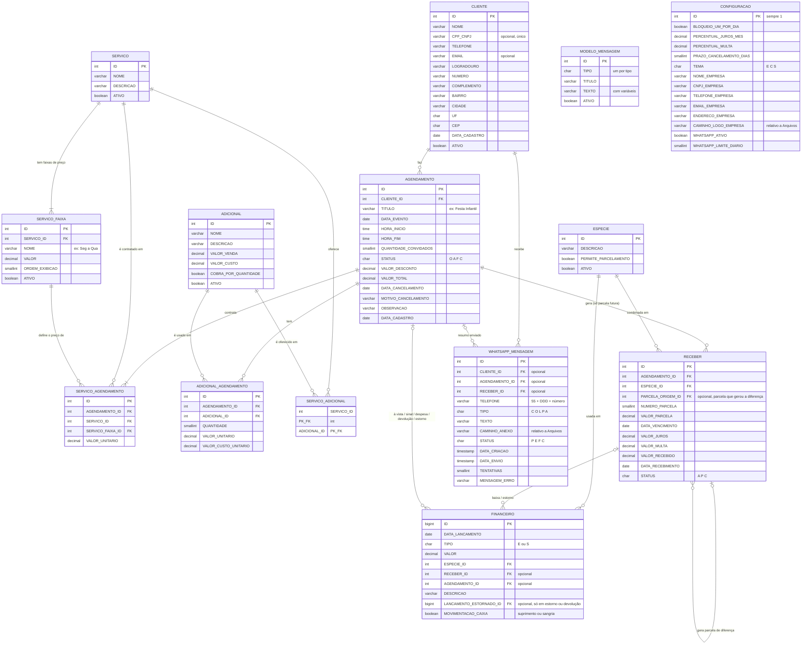

# Modelagem do Banco – Fest Agenda

> **Modelo fechado pelo grupo em 27/09/2026**, com base no conceitual (Chen, brModelo) validado entidade por entidade, relacionamento por relacionamento.
> **Atualizado em 28/09/2026:** Firebird 5 + Entity Framework Core; nomes por extenso no padrão do Firebird; tabela CONFIGURACAO; juros/multa e parcela de diferença no RECEBER; `ATIVO` em CLIENTE e ESPECIE; data de cancelamento. As regras de negócio completas estão no `fluxo-sistema.md`.
> **Atualizado em 29/09/2026 (revisão do protótipo, aprovada pelo grupo):** `TITULO`, `HORA_INICIO` e `HORA_FIM` no AGENDAMENTO; `CPF_CNPJ`, `EMAIL` e endereço detalhado no CLIENTE; dados da empresa e `TEMA` na CONFIGURACAO; o `config.ini` fica só com a conexão do banco.
> **Atualizado em 30/09/2026:** `LOGO_EMPRESA` (BLOB) → `CAMINHO_LOGO_EMPRESA` (caminho relativo à pasta `Arquivos\`); novo prefixo `CAMINHO_`; `TEMA` padrão `C` (claro). Script: `Database/alteracoes-2026-09-30.sql`.
> **Atualizado em 04/10/2026 (ajustes v2):** tamanhos dos VARCHAR fechados (tabela em "Tipos e domínios"); `CLIENTE.TELEFONE` só com dígitos, `VARCHAR(11)`. Script: `Database/alteracoes-2026-10-04.sql`. A 13ª tabela (`MENSAGEM_WHATSAPP`, grupo "Comunicação") está **pendente**: depende da decisão sobre o serviço de WhatsApp (ver "Pontos em aberto").

## Visão geral

São **14 tabelas**, divididas em cinco grupos:

| Grupo | Tabelas |
|---|---|
| Cadastros | CLIENTE, SERVICO, SERVICO_FAIXA, ADICIONAL, SERVICO_ADICIONAL, ESPECIE |
| Agendamento | AGENDAMENTO, SERVICO_AGENDAMENTO, ADICIONAL_AGENDAMENTO |
| Financeiro | RECEBER, FINANCEIRO |
| Configuração | CONFIGURACAO |
| Comunicação (18/10/2026) | WHATSAPP_MENSAGEM, MODELO_MENSAGEM |

## Convenção de nomes

| Onde | Padrão | Exemplo |
|---|---|---|
| Banco (tabelas e campos) | MAIÚSCULO, palavras separadas por `_`, **por extenso**, sem aspas | `SERVICO_AGENDAMENTO`, `VALOR_PARCELA`, `DATA_VENCIMENTO` |
| C# (classes e propriedades) | PascalCase | `ServicoAgendamento`, `ValorParcela` |
| C# (variáveis e parâmetros) | camelCase | `servicoAgendamento`, `valorParcela` |

- O banco fica no padrão natural do Firebird: sem aspas, o SQL manual (IBExpert, scripts, relatórios) funciona sem cuidado extra.
- O Entity Framework Core faz a ponte entre os dois padrões. Isso **precisa ser configurado**: por padrão o EF usaria o nome da propriedade (`ValorParcela`) como nome da coluna. A saída é uma convenção única no `OnModelCreating` que converte PascalCase para MAIÚSCULO_COM_UNDERSCORE em todas as entidades (ou `ToTable`/`HasColumnName` por entidade).
- Chave primária sempre `ID`; chave estrangeira sempre `<TABELA>_ID` (ex.: `CLIENTE_ID`).
- Datas começam com `DATA_`, horas com `HORA_`, valores com `VALOR_`, percentuais com `PERCENTUAL_`, quantidades com `QUANTIDADE_`, **caminhos de arquivo com `CAMINHO_`**.

## Diagrama ER (modelo lógico)



> CLIENTE ganhou `ACEITA_WHATSAPP` (boolean, padrão verdadeiro) em 18/10/2026; o diagrama acima mostra só os campos novos das tabelas de comunicação.

> **FINANCEIRO** é o "caixa": o que entrou ou saiu de fato. Nas telas do sistema pode continuar aparecendo como "Caixa" — é a mesma tabela.

## Dicionário das tabelas

### Cadastros

**CLIENTE**: quem contrata o evento, pessoa física ou jurídica.
- `CPF_CNPJ` é opcional; se preenchido, deve ser um CPF **ou** CNPJ válido e único (RN01). Gravado **só com dígitos** (11 ou 14); a máscara é aplicada na tela.
- `TELEFONE` obrigatório, gravado **só com dígitos** com DDD (10 ou 11); a máscara `(99) 99999-9999` é só da tela. `EMAIL` opcional.
- Endereço opcional e detalhado: `LOGRADOURO`, `NUMERO`, `COMPLEMENTO`, `BAIRRO`, `CIDADE`, `UF`, `CEP`. `CEP` gravado só com dígitos (8).
- `ATIVO`: cliente com agendamento não é excluído, é inativado (RN02).

**SERVICO**: o serviço principal (o espaço: Salão Principal, Espaço Gourmet). Não guarda preço.

**SERVICO_FAIXA**: as faixas de preço de cada serviço, criadas livremente (ex.: "Seg a Qua", "Fim de semana/Feriado", "Promoção de setembro").
- Sem regra de dia da semana no banco: no agendamento, ela escolhe a faixa num radio button.
- `ORDEM_EXIBICAO` define a ordem na tela e no catálogo (arrastar e soltar na tela do serviço).
- `ATIVO`: faixa usada em agendamento não é excluída, é inativada. Serve também para promoções: cria a faixa, usa enquanto durar, depois inativa.

**ADICIONAL**: garçom, comida, decoração, DJ, etc.
- `VALOR_VENDA` é o que se cobra do cliente; `VALOR_CUSTO` é o que a empresa paga (ex.: o garçom).
- `COBRA_POR_QUANTIDADE`: se verdadeiro, total = quantidade × valor (garçom, comida por pessoa).
- Na interface, os adicionais são cadastrados **dentro da tela do serviço** (ver `design-interface.md`); no banco continuam independentes, ligados pela SERVICO_ADICIONAL.

**SERVICO_ADICIONAL**: quais adicionais cada serviço oferece. Tabela N:N pura, sem atributo próprio, PK composta (`SERVICO_ID`, `ADICIONAL_ID`).
- Um adicional pode servir a vários serviços (garçom serve qualquer espaço); prepara o sistema pra quando houver mais de um serviço/espaço, cada um com sua lista.

**ESPECIE**: formas de pagamento (dinheiro, pix, cartão…).
- `PERMITE_PARCELAMENTO`: se essa espécie aceita mais de 1 parcela (ex.: cartão de crédito sim, dinheiro não).
- `ATIVO`: espécie usada não é excluída, é inativada (RN02).
- Taxa da maquininha e desconto automático por espécie ficaram fora por enquanto (ver "Pontos em aberto").

### Agendamento

**AGENDAMENTO**: o evento.
- `TITULO`: nome curto do evento (ex.: "Festa Infantil", "Casamento", "Festa Universitária"), mostrado no calendário e na agenda do dia. Obrigatório.
- `HORA_INICIO` e `HORA_FIM`: horário do evento, ambos obrigatórios. **`HORA_FIM` menor que `HORA_INICIO` significa que o evento termina no dia seguinte** (ex.: 23:00 – 02:00); por isso não há CHECK comparando as duas (RN28). O evento pertence sempre à `DATA_EVENTO` (dia do início), inclusive para o bloqueio de disponibilidade.
- `STATUS`: **O** = orçamento, **A** = agendado, **F** = faturado, **C** = cancelado.
- `VALOR_TOTAL` = soma dos serviços + soma dos adicionais − desconto.
- `VALOR_DESCONTO`: manual, só pode ser informado até o faturamento.
- `DATA_CANCELAMENTO` e `MOTIVO_CANCELAMENTO`: obrigatórios ao cancelar e vazios nos demais casos (CHECK). O cancelamento só pode ocorrer **até a data do evento, inclusive** (CHECK `DATA_CANCELAMENTO <= DATA_EVENTO`).
- **Faturado é imutável:** itens, valores, desconto e formas de pagamento não mudam mais; a única ação é cancelar (garantido pela aplicação).
- **Orçamento com sinal:** é o orçamento que tem entrada no FINANCEIRO ligada a ele. Não precisa de campo próprio.

**SERVICO_AGENDAMENTO**: os serviços principais de cada agendamento.
- Hoje, na prática, cada agendamento terá um serviço, mas o modelo já aceita vários (ex.: salão + área externa).
- `VALOR_UNITARIO` vem da faixa escolhida e pode ser alterado.

**ADICIONAL_AGENDAMENTO**: os adicionais contratados em cada agendamento.
- Só aparecem, na tela, os adicionais vinculados (via SERVICO_ADICIONAL) ao(s) serviço(s) escolhido(s) nesse agendamento.
- `VALOR_UNITARIO` e `VALOR_CUSTO_UNITARIO` são **copiados** do cadastro no momento do agendamento. Se o preço mudar depois, o agendamento antigo não muda.
- O total da linha não é gravado: é `QUANTIDADE × VALOR_UNITARIO`.

### Financeiro

**RECEBER**: as parcelas **ainda não pagas**, com vencimento no futuro.
- Liga direto no `AGENDAMENTO_ID` e no `ESPECIE_ID` (a espécie **combinada**).
- `STATUS`: **A** = aberto, **P** = pago, **C** = cancelado.
- `VALOR_JUROS`, `VALOR_MULTA`, `VALOR_RECEBIDO` e `DATA_RECEBIMENTO` são preenchidos na baixa. `VALOR_RECEBIDO` é o total que entrou (parcela + multa + juros, ou menos, se for pagamento parcial).
- `PARCELA_ORIGEM_ID`: preenchido só na parcela criada para cobrar a diferença de uma baixa parcial; aponta para a parcela original.
- **Só existe quando tem algo pendente.** Pagamento feito na hora (à vista ou sinal) não passa por aqui — vai direto pro FINANCEIRO.

**Cálculo de juros e multa (na baixa de parcela vencida):**
```
juros_dia   = VALOR_PARCELA × PERCENTUAL_JUROS_MES ÷ 100 ÷ 30
VALOR_JUROS = juros_dia × dias_de_atraso
VALOR_MULTA = VALOR_PARCELA × PERCENTUAL_MULTA ÷ 100
total       = VALOR_PARCELA + VALOR_MULTA + VALOR_JUROS
```
Exemplo: parcela R$ 1.000,00, juros 2% a.m., multa 2%, 15 dias de atraso → juros R$ 10,00, multa R$ 20,00, total R$ 1.030,00. Mês comercial de 30 dias.

**Baixa parcial:** se `VALOR_RECEBIDO` for menor que o total, o sistema pergunta se deseja criar uma nova parcela com a diferença (novo vencimento, `PARCELA_ORIGEM_ID` = parcela original). Em qualquer caso a parcela original fica **P**; se a resposta for não, a diferença é perdoada.

**FINANCEIRO**: o que **entrou ou saiu de fato** ("caixa"). Duas FKs opcionais, no máximo uma preenchida:

| Lançamento | RECEBER_ID | AGENDAMENTO_ID |
|---|---|---|
| Baixa de parcela, estorno de baixa | preenchido | vazio |
| Pagamento à vista, sinal, despesa do evento, devolução, estorno de à vista/sinal | vazio | preenchido |
| Lançamento avulso (compra de material) | vazio | vazio |

- `ESPECIE_ID` é sempre preenchido (a espécie **real**, o que aconteceu de fato — pode ser diferente da combinada em RECEBER).
- `LANCAMENTO_ESTORNADO_ID` (desde 18/10/2026, `alteracoes-2026-10-18.sql`): só na saída de estorno ou de devolução por cancelamento, aponta para a entrada desfeita (baixa de parcela, sinal ou entrada avulsa), com a mesma origem dela. Separa estorno e devolução de despesa do evento (todas são saídas ligadas ao agendamento), faz o sinal estornado deixar de bloquear a data e, com índice único, impede desfazer a mesma entrada duas vezes. CHECK: só em saída. Devoluções anteriores a essa data não apontam para a entrada; o sistema as reconhece pela descrição "Devolução por cancelamento – …" no agendamento cancelado.

### Configuração

**CONFIGURACAO**: parâmetros de negócio, dados da empresa e preferência de tema, ajustados pela tela de Configurações. Tabela de **uma linha só** (`ID = 1`, garantido por CHECK), com um campo por parâmetro, para cada configuração ter nome e tipo próprios.

*Parâmetros de negócio (aba Parâmetros):*
- `BLOQUEIO_UM_POR_DIA`: se verdadeiro, cada serviço só pode estar em um agendamento por dia (ver regra 4).
- `PERCENTUAL_JUROS_MES`: juros simples ao mês por atraso.
- `PERCENTUAL_MULTA`: multa por atraso sobre o valor da parcela. Sugestão de padrão: 2% (limite usual do CDC para consumidor; confirmar com quem entende da parte jurídica).
- `PRAZO_CANCELAMENTO_DIAS`: cancelamento feito até esse número de dias antes do evento tem devolução.

*Aparência (aba Aparência):*
- `TEMA`: **C** = claro (padrão), **E** = escuro, **S** = seguir o Windows.

*Dados da empresa (aba Empresa), usados na navbar, na splash e no catálogo PDF:*
- `NOME_EMPRESA`, `CNPJ_EMPRESA` (só dígitos), `TELEFONE_EMPRESA`, `EMAIL_EMPRESA`, `ENDERECO_EMPRESA` (texto livre, uma linha — só é exibido, não é filtrado).
- `CAMINHO_LOGO_EMPRESA`: caminho da logo **relativo à pasta `Arquivos\`** do sistema (ex.: `Empresa\logo_20260930142501123.png`). Ao escolher a imagem, o sistema copia para `Arquivos\Empresa`, com nome único, reduzida para no máximo 512 px, em PNG. Opcional; sem logo (ou se o arquivo sumir), a interface mostra o nome/iniciais.

*WhatsApp (aba WhatsApp, 18/10/2026):*
- `WHATSAPP_ATIVO`: liga o servidor local do WhatsApp (padrão desligado; desligado, o sistema funciona igual).
- `WHATSAPP_LIMITE_DIARIO`: máximo de mensagens enviadas por dia (padrão 10, CHECK > 0; a tela aceita de 1 a 200).

### Comunicação (18/10/2026)

**WHATSAPP_MENSAGEM**: fila e histórico do WhatsApp; nada é apagado. Cada envio grava uma linha **P** (pendente) e passa a **E** (enviada, com `DATA_ENVIO`) ou **F** (falha, com `MENSAGEM_ERRO`); a falha pode ser reenviada (soma `TENTATIVAS`). O limite diário conta as **E** com `DATA_ENVIO` de hoje. `TELEFONE` guarda o número como foi enviado (só dígitos, com 55). `CAMINHO_ANEXO` é o PDF do catálogo, relativo a `Arquivos\` (`WhatsApp\catalogo_<data>.pdf`). `RECEBER_ID` e os tipos **L** (lembrete) e **P** (cobrança) ficam prontos para quando essas funções entrarem.

**MODELO_MENSAGEM**: textos padrão editáveis por ela, **um por tipo** (índice único em `TIPO`), com variáveis entre chaves (`{cliente}`, `{titulo}`, `{status}`, `{data}`, `{hora}`, `{servicos}`, `{valor}`, `{pago}`, `{saldo}`, `{empresa}`, `{telefone_empresa}`). Vem com os modelos de catálogo (**C**) e orçamento (**O**).

**CLIENTE.ACEITA_WHATSAPP**: consentimento (LGPD), marcado por padrão e desmarcável no cadastro; desmarcado, o sistema não envia.

**FINANCEIRO.MOVIMENTACAO_CAIXA**: suprimento (entrada) ou sangria (saída), que só movimentam o dinheiro do caixa; sempre avulso (CHECK: sem `RECEBER_ID`, `AGENDAMENTO_ID` nem `LANCAMENTO_ESTORNADO_ID`).

## Restrições (CHECK)

O banco guarda só as restrições **estruturais e fixas**. Regras que dependem de configuração (disponibilidade, prazo de devolução), a imutabilidade do faturado e a validação de CPF/CNPJ são feitas na aplicação.

```sql
-- FINANCEIRO: no máximo uma origem
ALTER TABLE FINANCEIRO ADD CONSTRAINT CK_FINANCEIRO_ORIGEM
  CHECK (RECEBER_ID IS NULL OR AGENDAMENTO_ID IS NULL);

-- FINANCEIRO: estorno é sempre saída
ALTER TABLE FINANCEIRO ADD CONSTRAINT CK_FINANCEIRO_ESTORNO
  CHECK (LANCAMENTO_ESTORNADO_ID IS NULL OR TIPO = 'S');

-- AGENDAMENTO: data e motivo obrigatórios só no cancelamento
ALTER TABLE AGENDAMENTO ADD CONSTRAINT CK_AGENDAMENTO_CANCELAMENTO
  CHECK ((STATUS = 'C' AND DATA_CANCELAMENTO IS NOT NULL AND MOTIVO_CANCELAMENTO IS NOT NULL)
      OR (STATUS <> 'C' AND DATA_CANCELAMENTO IS NULL AND MOTIVO_CANCELAMENTO IS NULL));

-- AGENDAMENTO: cancelamento só até a data do evento, inclusive (RN27)
ALTER TABLE AGENDAMENTO ADD CONSTRAINT CK_AGENDAMENTO_DATA_CANCELAMENTO
  CHECK (DATA_CANCELAMENTO IS NULL OR DATA_CANCELAMENTO <= DATA_EVENTO);

-- CLIENTE: CPF (11) ou CNPJ (14) dígitos; os dígitos verificadores são validados na aplicação
ALTER TABLE CLIENTE ADD CONSTRAINT CK_CLIENTE_CPF_CNPJ
  CHECK (CPF_CNPJ IS NULL OR CHAR_LENGTH(CPF_CNPJ) IN (11, 14));

-- CONFIGURACAO: uma linha só
ALTER TABLE CONFIGURACAO ADD CONSTRAINT CK_CONFIGURACAO_UNICA CHECK (ID = 1);
```

Status, tipos e tema ficam garantidos pelos domínios (ver "Tipos e domínios").

## Regras de negócio que afetam o banco

A lista completa e numerada está no `fluxo-sistema.md`. As que mexem na estrutura ou nos dados:

1. **Valores congelados (RN08):** o agendamento guarda os valores praticados; mudar o cadastro não altera eventos já lançados.
2. **Nada é excluído se já foi usado (RN02, RN25):** cadastros usados são inativados; histórico financeiro nunca é apagado.
3. **Todo agendamento tem pelo menos um serviço (RN05).**
4. **Disponibilidade configurável (RN10, RN11):** com `BLOQUEIO_UM_POR_DIA` ligado, um serviço só pode estar em um agendamento por dia com status A, F, ou O **com sinal**. Orçamento sem sinal não bloqueia. O dia considerado é sempre a `DATA_EVENTO`, mesmo que o evento passe da meia-noite. Validado na aplicação.
5. **Adicionais oferecidos no agendamento** são só os vinculados, via SERVICO_ADICIONAL, ao(s) serviço(s) escolhidos (RN07).
6. **RECEBER só existe pra dívida futura (RN12, RN16).** Pagamento feito na hora (à vista, sinal) grava direto em FINANCEIRO, ligado ao agendamento.
7. **Espécie é só referenciada**, nunca pelo agendamento direto: o mesmo agendamento pode usar várias espécies ao mesmo tempo.
8. **Faturado é imutável (RN17):** só pode ser cancelado.
9. **Juros, multa e baixa parcial (RN18, RN19):** ver cálculo em RECEBER.
10. **Estorno de baixa (RN21):** reabre a parcela (limpa juros, multa, valor e data recebidos), lança saída no FINANCEIRO ligada à parcela e cancela a parcela de diferença, se houver.
11. **Estorno de à vista ou sinal (RN26):** saída no FINANCEIRO ligada ao agendamento.
12. **Cancelamento (RN22–RN24, RN27):** só até a data do evento; exige data e motivo; parcelas em aberto viram canceladas e não são cobradas; se feito até `PRAZO_CANCELAMENTO_DIAS` antes do evento, tudo que foi pago (sinal e parcelas) é devolvido como saída no FINANCEIRO ligada ao agendamento; depois do prazo, não há devolução.
13. **Evento que passa da meia-noite (RN28):** `HORA_FIM` < `HORA_INICIO` indica término no dia seguinte.

## Decisões de modelagem (justificativas)

- **Sem FORMA_PAGAMENTO_AGENDAMENTO.** Existia pra guardar "o que foi combinado", mas tudo que ela tinha (agendamento, espécie, valor, parcelas) já está no RECEBER. Manter as duas era redundância.
- **RECEBER só guarda dívida futura, não histórico de tudo que já foi pago.** Uma parcela que nasce e já é baixada no mesmo instante (pagamento à vista) não precisa existir — vai direto pro FINANCEIRO.
- **SERVICO_ADICIONAL existe mesmo com um serviço só hoje**, porque prepara o sistema pra quando houver um segundo espaço com adicionais próprios, sem precisar redesenhar nada. A tela esconde essa tabela: para o usuário, o adicional é cadastrado dentro do serviço.
- **FINANCEIRO com duas FKs opcionais em vez de um campo genérico de origem.** Um campo "módulo + id" apontando para tabelas diferentes (*polymorphic association*) não permite FK, e a integridade teria de ser simulada com triggers. Duas FKs mantêm a integridade no próprio banco — o preço é o CHECK garantindo que nunca as duas vêm preenchidas juntas, algo que a cardinalidade do ER sozinha não expressa.
- **`VALOR_TOTAL` no AGENDAMENTO é uma desnormalização consciente.** Poderia ser calculado, mas o calendário e os relatórios leem esse valor o tempo todo. A aplicação recalcula e grava sempre que os itens mudam (só até faturar).
- **`STATUS` no RECEBER**, pelo mesmo motivo: filtrar as contas em aberto sem calcular.
- **Total da linha em ADICIONAL_AGENDAMENTO não é gravado**, porque é uma conta simples feita na hora.
- **`DATA_CANCELAMENTO` gravada** para o histórico e para permitir o CHECK de "só até a data do evento" direto no banco — é uma regra fixa, não configurável.
- **Juros e multa gravados separados em RECEBER** (e não só somados no `VALOR_RECEBIDO`), para relatórios e para o banco ser autoexplicativo.
- **`PARCELA_ORIGEM_ID` em vez de reaproveitar a parcela original** na baixa parcial: a parcela paga fica fechada com o que realmente entrou, e a diferença tem vencimento e status próprios, mantendo o rastro.
- **CONFIGURACAO com uma coluna por parâmetro, em vez de chave/valor.** Cada parâmetro tem nome e tipo definidos no banco, o que facilita leitura e manutenção.
- **Regras configuráveis ficam fora do banco.** Bloqueio por dia e prazo de devolução podem ser ligados/alterados pelo usuário; por isso são validados na aplicação, não por trigger ou índice.
- **Nomes do banco no padrão do Firebird (MAIÚSCULO_COM_UNDERSCORE, sem aspas)** e PascalCase no C#, com o EF fazendo o mapeamento. camelCase no banco exigiria aspas em todo SQL manual.
- **`HORA_EVENTO` virou `HORA_INICIO`**, para formar par com `HORA_FIM`.
- **Sem data de término no AGENDAMENTO.** Evento que passa da meia-noite é reconhecido por `HORA_FIM` < `HORA_INICIO`; um segundo campo de data só serviria para eventos de mais de um dia, que não existem nesse negócio.
- **`CPF_CNPJ` num campo só**, em vez de dois campos ou um tipo de pessoa: a quantidade de dígitos (11 ou 14) já diz qual é, e a busca e a unicidade ficam num índice só.
- **Dados da empresa na CONFIGURACAO, não no `config.ini`:** ela edita pela tela, sem mexer em arquivo, e a informação vai junto com o banco.
- **Logo como arquivo, com o caminho no banco (30/09/2026, substitui "logo como BLOB"):** com o instalador, tudo fica numa pasta só (`C:\FestAgenda`), com `BD\` e `Arquivos\` lado a lado e nenhuma das duas apagada na desinstalação; o banco fica menor e as imagens podem ser vistas/copiadas direto. O caminho é **relativo a `Arquivos\`**, então mover a pasta do sistema não quebra nada. Arquivo sumido não quebra a tela: mostra o placeholder. Para backup completo, copiar `BD\` e `Arquivos\`.
- **`ENDERECO_EMPRESA` em texto livre**, diferente do cliente: só é exibido (catálogo, Sobre), nunca filtrado por cidade ou bairro.

## Tipos e domínios

**Tipos (Firebird 5):**
- IDs como INTEGER; no FINANCEIRO, BIGINT.
- Dinheiro como NUMERIC(18,2) (gravado como inteiro de 64 bits); percentuais como NUMERIC(5,2).
- Flags (ativo, permite parcelamento, etc.) como **BOOLEAN** nativo: o EF mapeia direto para `bool`, sem conversor.
- Status, tipo de lançamento e tema como CHAR(1).
- DATE quando não precisa de hora, não TIMESTAMP; horas como TIME.
- CPF/CNPJ, CNPJ da empresa e CEP como VARCHAR/CHAR **só com dígitos**; a máscara é da tela.
- Caminhos de arquivo como VARCHAR(260) (domínio `D_CAMINHO_ARQUIVO`), relativos à pasta `Arquivos\` do sistema.
- VARCHAR com tamanho justo, igual ao `MaxLength` da tela e ao `HasMaxLength` do EF:

| Campo | Tipo |
|---|---|
| CLIENTE.NOME | VARCHAR(100) |
| CLIENTE.TELEFONE | VARCHAR(11), só dígitos |
| CLIENTE.CPF_CNPJ | VARCHAR(14), só dígitos |
| CLIENTE.EMAIL | VARCHAR(100) |
| CLIENTE.LOGRADOURO / COMPLEMENTO / BAIRRO / CIDADE | VARCHAR(100) / (60) / (60) / (60) |
| CLIENTE.NUMERO | VARCHAR(10) |
| CLIENTE.UF / CEP | CHAR(2) / CHAR(8) |
| AGENDAMENTO.TITULO | VARCHAR(80) |
| AGENDAMENTO.MOTIVO_CANCELAMENTO | VARCHAR(200) |
| AGENDAMENTO.OBSERVACAO | VARCHAR(500) |
| SERVICO.NOME / SERVICO_FAIXA.NOME / ADICIONAL.NOME / ESPECIE.DESCRICAO | VARCHAR(80) |
| SERVICO.DESCRICAO / ADICIONAL.DESCRICAO | VARCHAR(255) |
| FINANCEIRO.DESCRICAO | VARCHAR(200) |

O Firebird só deixa **aumentar** um VARCHAR com `ALTER COLUMN ... TYPE`; para diminuir, o `alteracoes-2026-10-04.sql` recria a coluna (coluna nova, cópia, troca de nome e posição) e recria o índice e o CHECK que dependiam dela.

**Domínios propostos** (definidos uma vez, usados em todas as tabelas):
```sql
CREATE DOMAIN D_VALOR              AS NUMERIC(18,2) DEFAULT 0 NOT NULL;
CREATE DOMAIN D_PERCENTUAL         AS NUMERIC(5,2)  DEFAULT 0 NOT NULL;
CREATE DOMAIN D_ATIVO              AS BOOLEAN DEFAULT TRUE NOT NULL;
CREATE DOMAIN D_STATUS_AGENDAMENTO AS CHAR(1) NOT NULL CHECK (VALUE IN ('O','A','F','C'));
CREATE DOMAIN D_STATUS_RECEBER     AS CHAR(1) NOT NULL CHECK (VALUE IN ('A','P','C'));
CREATE DOMAIN D_TIPO_LANCAMENTO    AS CHAR(1) NOT NULL CHECK (VALUE IN ('E','S'));
CREATE DOMAIN D_TEMA               AS CHAR(1) DEFAULT 'C' NOT NULL CHECK (VALUE IN ('E','C','S'));
CREATE DOMAIN D_UF                 AS CHAR(2);
CREATE DOMAIN D_CAMINHO_ARQUIVO    AS VARCHAR(260);
```

**Índices:**
- Em todas as FKs (o Firebird cria sozinho).
- AGENDAMENTO(DATA_EVENTO), para o calendário.
- RECEBER(STATUS, DATA_VENCIMENTO), para o contas a receber.
- FINANCEIRO(DATA_LANCAMENTO), para o relatório de caixa.
- FINANCEIRO(LANCAMENTO_ESTORNADO_ID), único: uma entrada só pode ser estornada ou devolvida uma vez.
- CLIENTE(NOME), para busca.
- CLIENTE(CPF_CNPJ), único.

**CPF/CNPJ único mas opcional:** no Firebird, índice único comum já aceita vários nulos.

**Autodocumentação:** toda tabela e todo campo recebem `COMMENT ON`, para o significado ficar no próprio banco.

## Fora do banco (arquivo `config.ini`)

Só a **conexão com o banco de dados**: `Tipo` (`Embarcado`, padrão, ou `Servidor`), `Caminho` (relativo à pasta do sistema, ex.: `BD\basefestagenda.fdb`, ou absoluto), `Servidor`, `Porta`, `Usuario`, `Senha`. É a única coisa que precisa ser lida antes de o banco estar acessível. Parâmetros de negócio, dados da empresa e tema ficam na tabela CONFIGURACAO; a logo fica em `Arquivos\Empresa`, com o caminho na CONFIGURACAO.

Scripts em `Database/`: `schema.sql` (estrutura e `COMMENT ON`), `dados-iniciais.sql` (CONFIGURACAO ID = 1 e espécies padrão) e `alteracoes-*.sql` (atualizações de bancos antigos). O instalador já leva um banco vazio criado com os dois primeiros.

No .NET, o `.ini` é lido pelo pacote gratuito `Microsoft.Extensions.Configuration.Ini`.

## Pontos em aberto

- [x] Banco: **Firebird 5**, acesso via **Entity Framework Core** (`FirebirdSql.EntityFrameworkCore.Firebird`).
- [x] Nomes por extenso, padrão do Firebird no banco e PascalCase no C#.
- [x] Flags como BOOLEAN nativo.
- [x] Campos do protótipo aprovados (título e horário do evento, CPF/CNPJ, e-mail, endereço detalhado, dados da empresa, tema).
- [x] Tamanhos exatos dos VARCHAR: fechados em 04/10/2026 (tabela em "Tipos e domínios").
- [x] Tabelas de comunicação criadas em 18/10/2026 (`alteracoes-2026-10-18.sql`): `WHATSAPP_MENSAGEM` e `MODELO_MENSAGEM`, domínios `D_TIPO_MENSAGEM` e `D_STATUS_MENSAGEM`. O nome segue o `prompt-whatsapp-finalizacao.md` (`WHATSAPP_MENSAGEM`), não o `MENSAGEM_WHATSAPP` do `ajustes.md`. A sessão do WhatsApp fica em arquivo (`Whatsapp\sessao`), não no banco.
- [x] Limite de tamanho da logo: reduzida para no máximo 512 px ao salvar (agora em arquivo, `CAMINHO_LOGO_EMPRESA`).
- [ ] Taxa da maquininha e desconto automático por espécie ficaram fora da v1 (decisão consciente); hoje o desconto é sempre manual, no campo `VALOR_DESCONTO` do agendamento.